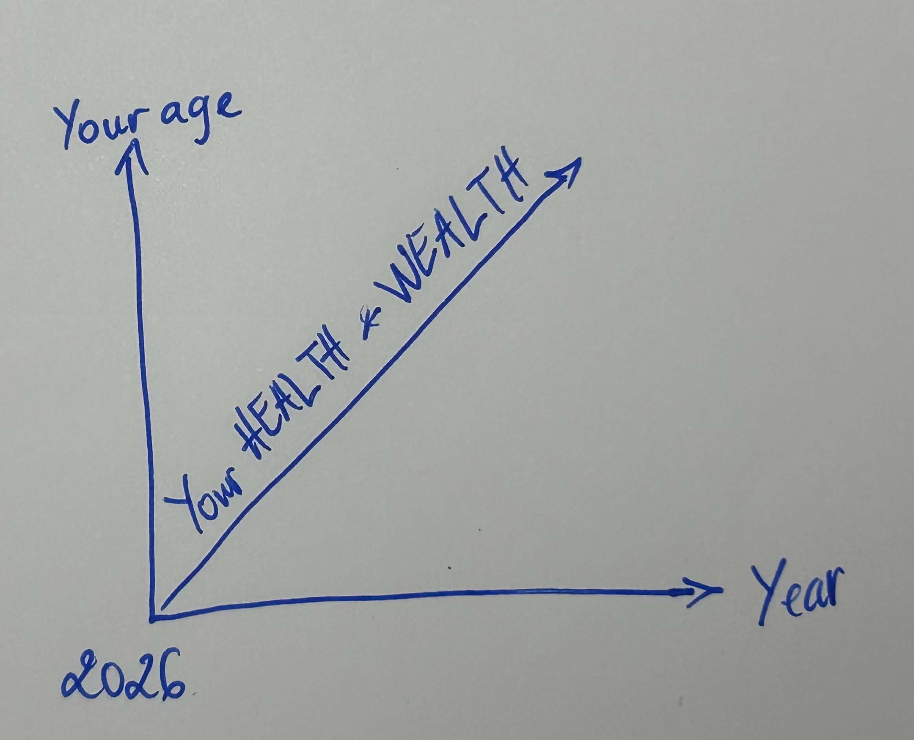

# HEALTH & WEALTH
My mind has gone blank. I can't think of anything to say. I dunno, I just made something that I hope you'll find funny. Just read the text below to the end!

# You have a functional equation

$$
H(T) = H_0 + W \times (T - 2026)
$$

If $H_0 = 32, \quad W = 1$

$H(T) = 32 + 1 \times (T - 2026)$
$\Rightarrow H(T) = T - 1994$

If $T = 2026$:

$H(T) = 32 + 1 \times (T - 2026)$
$\Rightarrow H(T) = T - 1994$

It means:

$$
\lim_{T \to +\infty} H(T) = +\infty
$$

**Happy birthday(T) = Health + Wealth, always**

